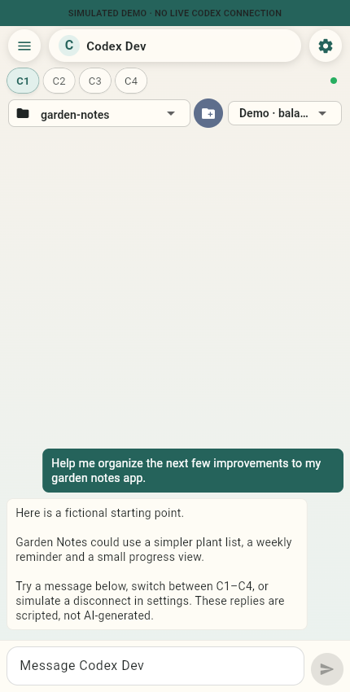
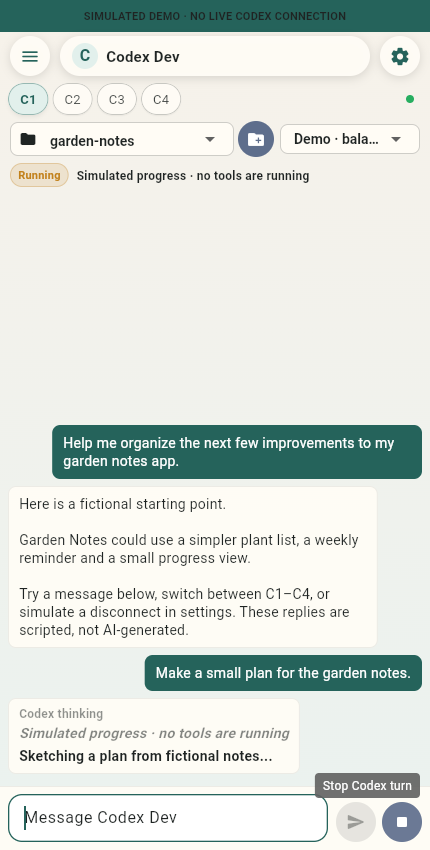
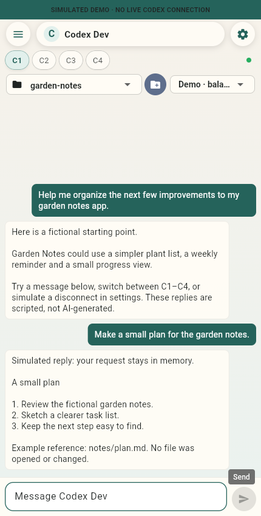
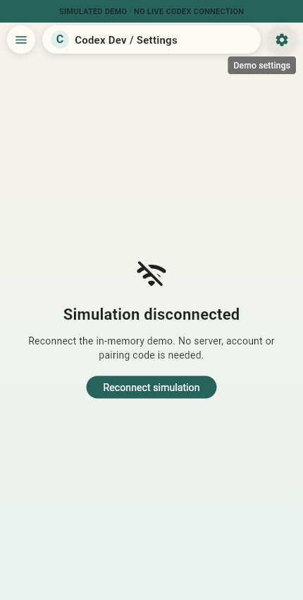

# Codex Dev

### A small screen for a focused conversation.

Four chat tabs, a draft that waits where you left it, progress while a reply is
on its way, and a clear path back after a disconnect. Codex Dev explores how a
phone-first development companion can feel.

**SIMULATED DEMO; NO LIVE CODEX CONNECTION.** Every reply, project and connection
state comes from an inert mock inside the app. There is no AI service, server
account, shell execution or access to your repositories.

<table>
<tr><th>Keep each thread in view</th><th>See a turn in progress</th></tr>
<tr><td></td><td></td></tr>
<tr><th>Read the scripted reply</th><th>Try a local reconnect</th></tr>
<tr><td></td><td></td></tr>
</table>

These are unmodified Chromium screenshots of the included Flutter app at a phone
viewport. All examples are fictional. The progress is scripted, not a recording
of an AI system's reasoning.

## Try the interface

Use Flutter 3.44.1 (Dart 3.12.1), Python 3, and a recent Chromium browser:

```bash
flutter pub get --enforce-lockfile
python3 scripts/check_demo_boundary.py
flutter analyze
flutter test
flutter build web --release --no-web-resources-cdn --no-wasm-dry-run
python3 -m http.server 8080 --bind 127.0.0.1 --directory build/web
```

Open `http://127.0.0.1:8080`. The local server supplies static app/font/renderer
files only; the running mock has no network API. All resources are built locally,
with no runtime CDN. Characters outside the bundled fonts may show a missing-glyph box. Type a fictional request, switch C1–C4, queue a second prompt,
or use **Demo settings → Simulate disconnect → Reconnect simulation**.
Drafts and chat survive that simulated reconnect, within the same process.
Reloading or restarting the app resets all session state.

For Android, install Java 17 and Android SDK/platform 36, then run:

```bash
flutter build apk --debug
```

This creates a local test APK. Android has no Internet permission. No APK, IPA,
release signing, app-store submission or hosted service is distributed here.
The included Android host is a Flutter host, not the deprecated native client.

## What you can explore

- Four independent chat tabs and per-tab drafts.
- A bounded prompt queue, scripted progress, cancellation and unread indicators.
- Fictional project/model selectors; paths are labels, never filesystem access.
- A session-only connection simulation and activity view.
- Original Flutter UI/controller source, focused tests and an explicit mock entry point.

The live HTTP client, production server/supervisor, command tools, credentials,
secure storage, real pairing, file sharing, speech plugin, deployment scripts,
private history and original artwork are excluded. Speech-controller tests use a
fake engine; the app itself has speech disabled. iOS/macOS/Windows/Linux hosts
are not included or validated. Model labels are illustrative, not a live model
catalogue or compatibility claim.

## Check the browser workflow

With Node 22 and the web build above:

```bash
npm ci --ignore-scripts
npx playwright install chromium
npm run test:browser
```

The source passed 18 Flutter tests, analyzer, web and Android builds, a real
API 35 emulator smoke check, and a browser workflow that blocks network access
after loading the static assets, including the first-turn symbol font. See [validation](docs/validation.md),
[architecture](docs/architecture.md) and [dependency notes](docs/dependencies.md).
These checks are bounded engineering evidence, not a security certification.

## Fork it and make it yours

Experimental and unmaintained. There is no support, review, security-update or
release commitment. The UI and state handling are here for people who want to
study, adapt or maintain a small development companion. Adding a live backend
would be a separate design and security project.

First-party source, tests and docs are [MIT](LICENSE); redistributed fonts,
Flutter template material and Gradle tooling retain their
[third-party notices](THIRD_PARTY_NOTICES.md). This is an independent project,
not affiliated with or endorsed by OpenAI. OpenAI and Codex names/marks remain
with their owners; this license grants no rights to those marks.
